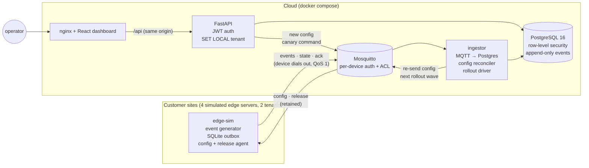

# edgefleet-sim

A small but realistic simulation of a cloud platform that manages **edge servers
at customer sites**. Picture an industrial-safety company: every warehouse has
an on-site edge server that runs AI on camera feeds, makes safety decisions
locally, and sends only **anonymised events** (never video) to the cloud.
From the cloud, operators watch the fleet, push **config** down to sites, and
roll out **software releases** safely, while sites drop offline and come back
whenever they like.

It's a portfolio project: about 3,000 lines of Python and 1,000 lines of
TypeScript, built in seven phases. Every design decision is explained in
[docs/LEARNING.md](docs/LEARNING.md). The whole stack runs on one laptop with
Docker Compose (about 300 MB of RAM).

## Architecture



| Service | What it does |
|---|---|
| `edge-sim` ×4 | Generates safety events (near miss, PPE violation, speed violation, ...), stores them in a local SQLite **outbox** first, publishes them in order, sends heartbeats, applies config, installs releases and **rolls back on its own** if a health check fails. |
| `mosquitto` | MQTT broker. Each device has its own login, and an ACL pins it to its own topic path: `tenants/{tenant}/sites/{site}/devices/{device}/{events,state,ack,config,release}`. |
| `ingestor` | Writes events and heartbeats to Postgres under the tenant taken from the topic. Acks to the broker only **after** the DB commit. Re-sends config to devices that are behind, and moves release rollouts forward. |
| `postgres` | Every tenant-owned table has an RLS policy. The app roles are not superusers, can't bypass RLS and own no tables. Events can't be updated or deleted, not even by the table owner. |
| `api` | REST API for the dashboard. The tenant comes only from the signed JWT and is applied per transaction with `SET LOCAL`. |
| `web` | React + TypeScript dashboard. API types are generated from the OpenAPI schema. |
| `migrate` | One-shot job: Alembic migrations + demo seed data. |

## Run it

You need Docker with Compose v2. The demo scripts also need `curl` and `jq`.

```bash
docker compose up -d --build
```

| What | Where |
|---|---|
| Dashboard | http://127.0.0.1:8080 |
| API docs (Swagger) | http://127.0.0.1:8000/docs |
| Postgres | `127.0.0.1:5433` (5432 is left free for a host Postgres) |
| MQTT | `127.0.0.1:1883` |

Seeded users (password `dev-password` for all; **dev seed data only**):

| Email | Tenant | Role |
|---|---|---|
| `operator@tenant-a.example` | tenant-a (2 sites, 3 devices) | operator: can change config and releases |
| `viewer@tenant-a.example` | tenant-a | viewer: read-only |
| `operator@tenant-b.example` | tenant-b (1 site, 1 device) | operator |

Within a few seconds the devices start reporting. Seeded config v1 is pushed
to them automatically by the ingestor's reconciliation (you'll see
`reconcile: ... re-sent v1` in `docker compose logs ingestor`).

Stop with `docker compose down`. Add `-v` to wipe all data and start fresh.

## Demos

### `scripts/demo-offline.sh [device] [seconds]`

Cuts one edge server off the network with `docker network disconnect`, waits,
then reconnects it. While offline, events pile up in the device's outbox; after
reconnecting they **backfill** in order. The script then checks the database:
no duplicate `seq`, no gaps, and how many events arrived late.

```
   60s offline: device outbox backlog = 20, cloud max seq = 2306
== Reconnecting
   backlog = 0, cloud max seq = 2327
   events stored: 21   distinct seq: 21   missing seq in range: 0
== OK: every event made it to the cloud exactly once
```

### `scripts/demo-bad-release.sh [version]`

Rolls out `2.0.0-bad` to tenant-a. The canary installs it, fails its health
check (0/8 cameras), **rolls itself back**, and the rollout **halts** before
any other device gets the update. Any version containing `bad` fails the health
check; `corrupt` fails the checksum instead.

### `scripts/demo-rls.sh`

Logs in to Postgres as the API's own role and shows: no tenant set → 0 rows;
as tenant-a → only tenant-a rows, even when asking for tenant-b by name;
writing a tenant-b row → refused; `SET row_security = off` → refused. Then the
same through the REST API: tenant-b's device and release are plain 404s.

Also try in the dashboard: stop a device (`docker compose stop edge-a1-01`) and
watch it go offline after 30 s; save a config with a speed limit above 25 km/h
and watch the devices reject it; open two tabs and save the same config twice
to get the conflict message.

## Tests

```bash
docker compose run --rm tests
```

25 integration tests against the **real** Postgres (RLS, grants and triggers
don't exist in SQLite or mocks), in a throwaway database that is created,
migrated, seeded and dropped per run:

- **RLS isolation**: each tenant sees only its rows; no tenant set → nothing;
  `SET LOCAL` doesn't leak to the next transaction on a pooled connection;
  cross-tenant writes and `row_security = off` are refused.
- **Idempotent ingestion**: the same `seq` twice → one row; first delivery wins;
  identity comes from the topic, not the payload.
- **Append-only events**: app roles lack UPDATE/DELETE; the trigger blocks
  UPDATE, DELETE and TRUNCATE even for the table owner.
- **Rollouts**: halt when the canary rolls back, fails or goes silent; wave 1
  is only sent after the canary succeeds; the release then completes.

## Project layout

```
backend/                Python 3.12: one image for api, ingestor, migrate, tests
  alembic/versions/     0001 schema+RLS · 0002 login lookup · 0003 config · 0004 releases
  app/api/              FastAPI routes (auth, fleet, events, kpis, configs, releases)
  app/ingestor.py       MQTT → Postgres, config reconciliation, rollout driver
  app/rollout.py        staged-rollout state machine
  tests/                pytest integration tests
edge-sim/               simulated edge server (outbox, config + release agent)
mosquitto/              broker config, ACL, dev passwords
postgres/init/          creates the three DB roles
web/                    React + Vite dashboard (src/api/schema.d.ts is generated)
scripts/                demo scripts
docs/LEARNING.md        concepts, design decisions, interview Q&A per phase
```

Development without Docker for the dashboard: `cd web && npm install && npm run dev`
(http://localhost:5173, proxies `/api` to the API on :8000). After changing the
API, run `npm run gen:api` to regenerate the TypeScript types.

## What this does NOT do

Be clear about the limits. This is a simulation, not a product:

- **No real computer vision.** Events are random but plausible; there are no
  cameras, models or video.
- **No real hardware.** Edge servers are containers. "Install" and "health
  check" are simulated; there is no bootloader or A/B partition.
- **No vehicle or machine control.** Nothing here acts on the physical world.
- **Single node.** One broker, one database, one of each service, no high availability.
- **Not production-hardened.** Shared-secret MQTT passwords and dev secrets
  are committed on purpose; no TLS; the JWT sits in `sessionStorage`; no rate
  limiting, monitoring or backups.

## Taking it to production

What I would change, roughly in order:

1. **Device identity**: an X.509 certificate per device over mutual TLS
   instead of passwords, issued at manufacturing and rotated, with the ACL
   keyed on the certificate's identity.
2. **Signed artifacts**: sign release images in the build pipeline and verify
   the signature on the device (checksums only prove integrity, not origin), e.g.
   with The Update Framework (TUF) or Sigstore-style signing.
3. **A/B partitions** on real devices: write to the inactive slot, boot once,
   commit only after the health check, with automatic fallback by the bootloader.
4. **Managed Postgres** with backups and point-in-time recovery, a read replica
   for dashboards, time-based partitioning of `events`, and an archive to
   write-once object storage (object lock) for evidence-grade retention.
5. **Managed or clustered MQTT** with TLS everywhere, and a durable log
   (e.g. Kafka) between the broker and the ingestor so processing can scale out
   and be replayed.
6. **Horizontal scaling**: several stateless API replicas behind a load
   balancer; ingestors sharded by tenant or using shared subscriptions; a
   single-leader rollout controller.
7. **Monitoring and alerting**: metrics (device online %, outbox backlog,
   ingest lag, rollout state), structured logs, traces, alerts on stuck
   rollouts and devices that stay offline.
8. **Auth**: an identity provider (OIDC/SSO), short-lived tokens in httpOnly
   cookies, a proper role model, audit logging of operator actions.
9. **Rollout policy**: more waves (1 → 5% → 25% → 100%), bake time between waves,
   automatic halt on fleet metrics, maintenance windows per site.
